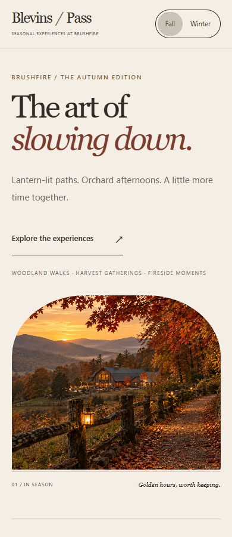
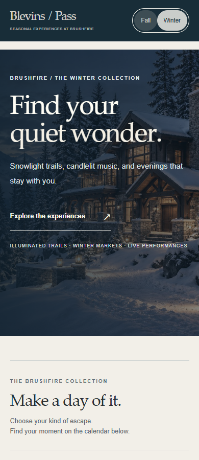
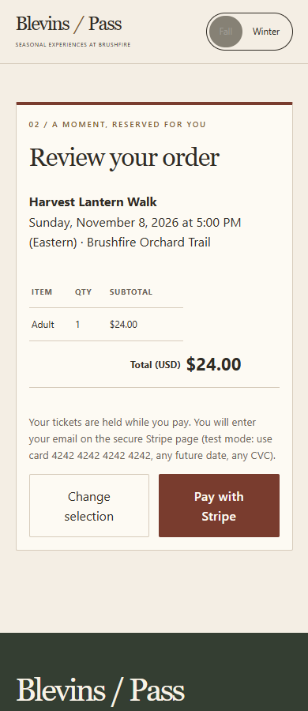
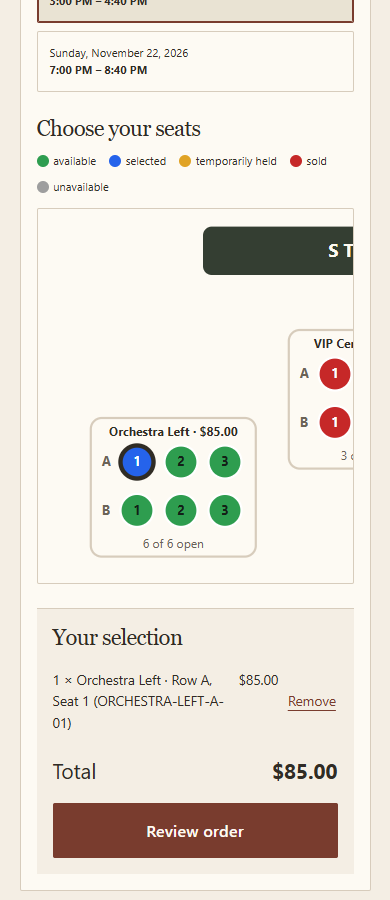

# UI-001 — screenshot review and verification

Scope: the existing discovery-to-ticket-review flow and concert seat selection, using the actual local API. Goal: make both seasonal identities distinctive while keeping booking information readable and functional. This is a bounded UI review, not a complete accessibility certification or payment audit.

## 1. Seasonal entry — improved

The original Fall and Winter screens used the same compact illustration/rounded-panel composition. The new Fall entry uses editorial asymmetry and an arched photograph; Winter uses an immersive photographic composition with dark framing. Both retain a visible season switch and a working discovery CTA. Hero text and controls were inspected on desktop and mobile.

Baseline: [Fall](01-fall-before.jpg), [Winter](02-winter-before.jpg). Desktop implementation: [Fall](fall-1440.png), [Winter](winter-1440.png).

## 2. Discovery and date selection — functional

The required six-event calendar remains. A numbered text index exposes full event names, registration type and server-derived prices before the booking section. At mobile widths, matching numbered calendar chips replace broken multi-line words; their full accessible labels remain. Month navigation and date/event selection are preserved. A two-pixel Winter overflow was detected and corrected.

## 3. Tickets and review — verified without payment submission

At each tested width, selecting an Adult ticket produces $24.00, theme switching preserves that total, and the review screen shows the same amount with an enabled Stripe action. Review now starts at its heading instead of inheriting the booking scroll position. Pay was not clicked.

## 4. Concert seats — keyboard selection verified

The existing seat chart keeps its section prices, performance-specific state and status colors. Enter selects a seat and enables Review. Hit rectangles provide at least 44px targets; scrolling remains inside the chart at narrow widths. Actual seat purchase, sold-state persistence after a real payment and confirmation refresh are separate final acceptance checks.

## Evidence and limits

The authorized Playwright script uses installed Chrome with the real local API at 1440, 1024, 768, 390 and 360px. [verification-results.json](verification-results.json) records 15 passed scenario records and zero uncaught page errors. It asserts no page overflow, theme/state preservation, review orientation, enabled purchase review, keyboard seat selection and target dimensions. It submits no orders/payments, restores the original persisted theme, and closes its own browser.

To reproduce, install/provide Playwright in a test environment, optionally set PLAYWRIGHT_MODULE to its index.mjs file URL, run the app normally, then run `node docs/ui-review/verify-ui.mjs` from the root. UI_ORIGIN can override the local frontend URL. Playwright is not an application dependency. Other saved viewport images are adjacent to this document.

Primary text-token contrast pairs were calculated; screenshots alone cannot establish full accessibility compliance. Physical-device behavior, screen-reader operation, every provider error, real payment confirmation and a complete cross-browser matrix were not tested in this pass. Do not describe the UI screenshots as proof of payment or inventory correctness. Design rules are canonical in [DESIGN_SYSTEM.md](../../DESIGN_SYSTEM.md).
